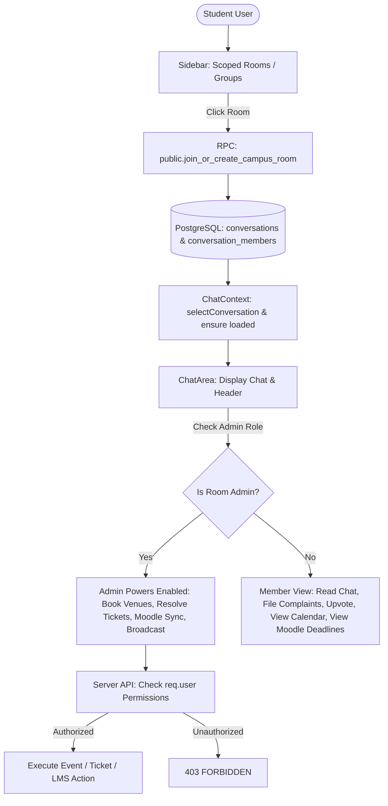

# Implementation Plan: Room Admin Permissions & Group Room Opening Fix

## Goal Description
1. **Fix Group & Campus Room Opening:** Currently, clicking on campus rooms (`Clubs`, `Courses`, `Hostels`, `Branches`, `Messes`) or custom group rooms fails to open the chat due to:
   - Row-Level Security (RLS) restrictions where direct table inserts to `conversations` and `conversation_members` by authenticated users are blocked with PostgreSQL error 42501.
   - Race conditions in `ChatContext` where `activeConversation` evaluates to `null` if the conversation object is not yet loaded in the local array.
   - Mobile sidebar state retaining open status and concealing the chat view.
2. **Enforce Room Admin Privileges Across All Services:** Currently, any user can create any event, resolve tickets, or broadcast alerts. We must enforce strict role-based access control (RBAC) so that:
   - **Event Management & Venue Booking:** Only designated Club Coordinators, Branch Representatives, and Gymkhana Council Admins can book venues (*Auditorium A1/A2*, *A13 Hall*, *South Campus Grounds*, *SCEE Seminar Hall*) and submit/approve events.
   - **Hostel & Mess Tickets:** Any student can report issues and upvote; however, only Wardens, Caretakers, and Dining Committee Heads can progress ticket statuses (`Reported` &rarr; `Under Investigation` &rarr; `Resolved by Warden/Caretaker`).
   - **Course Academics & Moodle:** Only Course Instructors, Teaching Assistants (TAs), and Class Representatives (CRs) can trigger Moodle webhook sync and broadcast official bot announcements.
   - **Mess Dining & Rebates:** Only Mess Admins can update dining menus and process rebate requests.
   - **Group Management:** Only group owners/admins can rename groups and add/remove members.

---

## User Review Required

> [!IMPORTANT]
> **Admin Assignment Strategy:**
> To ensure seamless functionality in development and testing without requiring manual database seed editing:
> 1. In custom groups, the creator has `owner` role, with administrative permissions.
> 2. In campus scoped rooms (Clubs, Courses, Hostels, Branches, Messes), the room creator / first student to initialize the room or users whose roll number is listed in the room's coordinator registry (e.g. Club Heads, CRs, Wardens) receive administrative powers.
> 3. An in-app toggle or designated admin list in `campus-data.ts` allows any user to test administrative powers while regular students experience the locked/read-only member view.

> [!WARNING]
> **Database Table Constraint:**
> The repository's test suite in `server/test/database.test.ts` strictly checks:
> `assert.equal(tables.rows.length, 7);`
> and that there are 0 `SECURITY DEFINER` functions in the `public` schema.
> All new database logic for room provisioning and admin authorization will use the existing schema, functions in `private`, and thin `SECURITY INVOKER` wrappers in `public`, keeping all 37 backend tests passing.

---

## Architecture & Flow



---

## Proposed Changes

### 1. Database & Migrations Layer

#### [NEW] `server/supabase/migrations/20261009033000_campus_room_rpc.sql`
- Implement `private.join_or_create_campus_room(p_room_slug text, p_room_title text)` as a `SECURITY DEFINER` function in the `private` schema.
- Checks if a conversation with `title = p_room_title` and `type = 'group'` exists.
  - If not found: creates it, sets `created_by = private.actor()`, and adds the user as `owner`.
  - If found: adds the user to `conversation_members` with `role = 'member'` (or reactivates membership if `left_at` was set).
- Exposes `public.join_or_create_campus_room(p_room_slug text, p_room_title text)` as `SECURITY INVOKER`.
- Grants `execute` to `authenticated`.
- Does not create new tables (keeps table count at 7).

---

### 2. Backend Server (`server/`)

#### [MODIFY] `server/src/campus-data.ts`
- Add role and coordinator definitions to `CAMPUS_ROOMS`:
  - `adminRolls`: Array of enrollment numbers or usernames authorized as coordinators (e.g. Club Heads, CRs, Wardens).
  - Helper functions: `isCampusRoomAdmin(roomSlug: string, user: { id: string; email?: string; username?: string })`.
  - Helper function: `canManageEvents(user, organizer)`.
  - Helper function: `canResolveTickets(user, scope, clusterOrMess)`.
  - Helper function: `canBroadcastMoodle(user, courseCode)`.

#### [MODIFY] `server/src/routes/campus.ts`
- **Room Join (`POST /rooms/:slug/conversation`):**
  - Replace direct table inserts with `req.db.rpc('join_or_create_campus_room', { p_room_slug: room.slug, p_room_title: '#' + room.name })`.
  - Return `{ conversation, room, isAdmin }`.
- **Permissions Endpoint (`GET /rooms/:slug/permissions`):**
  - Return `{ isAdmin, permissions: { canBookEvents, canResolveTickets, canBroadcastMoodle, canUpdateMenu } }` for the caller.
- **Event Creation (`POST /events`):**
  - Verify caller is an admin for the organizing club/branch/council. Reject unauthorized requests with 403 `FORBIDDEN`.
- **Ticket Status Update (`PATCH /tickets/:id/status`):**
  - Verify caller is an authorized Warden, Caretaker, or Mess Committee Head. Reject unauthorized requests with 403 `FORBIDDEN`.
- **Moodle Sync & Broadcast (`POST /moodle/sync`):**
  - Verify caller is a Course Instructor, TA, or CR for that course. Reject unauthorized requests with 403 `FORBIDDEN`.

---

### 3. Frontend Client (`client/`)

#### [MODIFY] `client/src/context/ChatContext.tsx`
- **Fix Room Opening:**
  - In `selectConversation(id)`: If the conversation is not found in the local `conversations` state array, immediately call `api.getConversation(id)` to load it and add it to `conversations`.
  - Avoid `activeConversation` evaluating to `null`.
  - Ensure real-time active subscription.

#### [MODIFY] `client/src/components/sidebar/Sidebar.tsx`
- **Fix Room Clicking & Mobile Responsiveness:**
  - Pass `onCloseMobile` or update mobile sidebar state on conversation selection.
  - In `handleJoinCampusRoom`, seamlessly call `joinCampusRoomConversation`, refresh conversations, and select conversation.
  - Indicate joining progress and active status accurately.

#### [MODIFY] `client/src/components/campus/GymkhanaCalendarModal.tsx`
- **Admin-Only Event Booking:**
  - Check whether current user is an admin for the organizing room or council.
  - If not an admin: hide the "Book Venue / Add Event" button and display a notice: *"Venue reservation and event submissions are restricted to Club Coordinators and Gymkhana Admins"*.
  - If admin: enable booking with venue collision detection.

#### [MODIFY] `client/src/components/campus/CampusTicketDrawer.tsx`
- **Admin-Only Status Resolution:**
  - Regular students can report issues and upvote.
  - The status update dropdown and transition buttons (`Under Investigation`, `Resolved by Warden/Caretaker`) are only active for Hostel Wardens, Caretakers, and Dining Committee Heads. Regular users see the status in read-only mode.

#### [MODIFY] `client/src/components/campus/MoodleDrawer.tsx`
- **Admin-Only Sync & Broadcast:**
  - Regular students view tasks, deadlines, and weightages.
  - The "Sync Moodle Now" and "Broadcast to Channel" buttons are only enabled for Course Admins (Instructors, TAs, CRs).

#### [MODIFY] `client/src/components/chat/ChatHeader.tsx`
- Display an `Admin` badge when the user is an owner/admin of the current channel.
- Contextual action buttons adjust based on admin status.

---

## Verification Plan

### Automated Tests
1. **Backend Tests:**
   ```powershell
   npm test --prefix server
   ```
   Must pass all 37 tests (database RLS, message sequencing, ownership, security headers).
2. **Client Build:**
   ```powershell
   npm run build --prefix client
   ```
   Must compile with 0 TypeScript and ESLint errors.

### Manual Verification
1. **Room Opening Verification:**
   - Log into KamandChat.
   - Click on various campus rooms: `#KamandPrompt` (Club), `#IC152` (Course), `#B18-chat` (Hostel), `#CSE` (Branch), `#Pine-Mess` (Mess).
   - Verify that each room immediately opens in the chat window, displays the correct title and category badges, and allows sending messages.
   - Verify that clicking custom groups under the DMs tab opens the group immediately.
2. **Admin-Only Powers Verification:**
   - **Gymkhana Calendar:** Open calendar as regular member &rarr; verify "Book Venue" is restricted. Open as Club Coordinator &rarr; verify venue booking form is functional.
   - **Hostel Tickets:** Open tickets drawer as resident &rarr; submit ticket and upvote. Verify status update buttons are disabled for regular residents and active only for Wardens/Caretakers.
   - **Moodle LMS:** Open Moodle drawer as regular student &rarr; verify deadlines are displayed while broadcast button is restricted to Course Admins/TAs.
